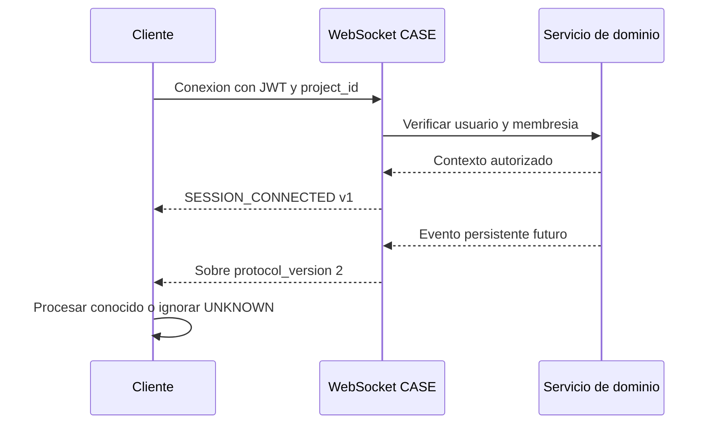

# Contratos WebSocket

## Sobre version 2

```json
{
  "protocol_version": 2,
  "type": "AI_MESSAGE_CREATED",
  "event_id": "uuid",
  "project_id": "uuid",
  "diagram_id": null,
  "sequence_number": 1,
  "correlation_id": "uuid",
  "occurred_at": "2026-10-15T12:00:00Z",
  "actor": {"user_id": "uuid", "display_name": "Editor UML"},
  "payload": {}
}
```

## Eventos definidos

- `AI_MESSAGE_CREATED`
- `AI_MESSAGE_STATUS_CHANGED`
- `AI_ACTION_PROPOSED`
- `AI_ACTION_STATUS_CHANGED`
- `AI_RECOMMENDATION_CREATED`
- `AI_CONVERSATION_SUMMARY_UPDATED`
- `FLUTTER_THEME_UPDATED`
- `PROJECT_VERSION_CREATED`
- `PROJECT_VERSION_RESTORED`

Son contratos de serializacion. Los eventos de capacidades aun inexistentes no se emiten artificialmente.

## Compatibilidad

El parser frontend conserva los eventos v1 `SESSION_CONNECTED`, `UML_EVENT`, `EVENT_ACK`, `EVENT_REJECTED` y `PONG`. Los eventos desconocidos se convierten a `UNKNOWN`; JSON invalido se ignora y no desconecta al cliente.



