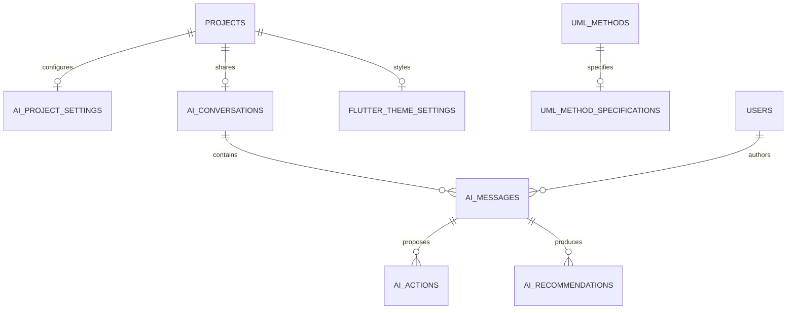
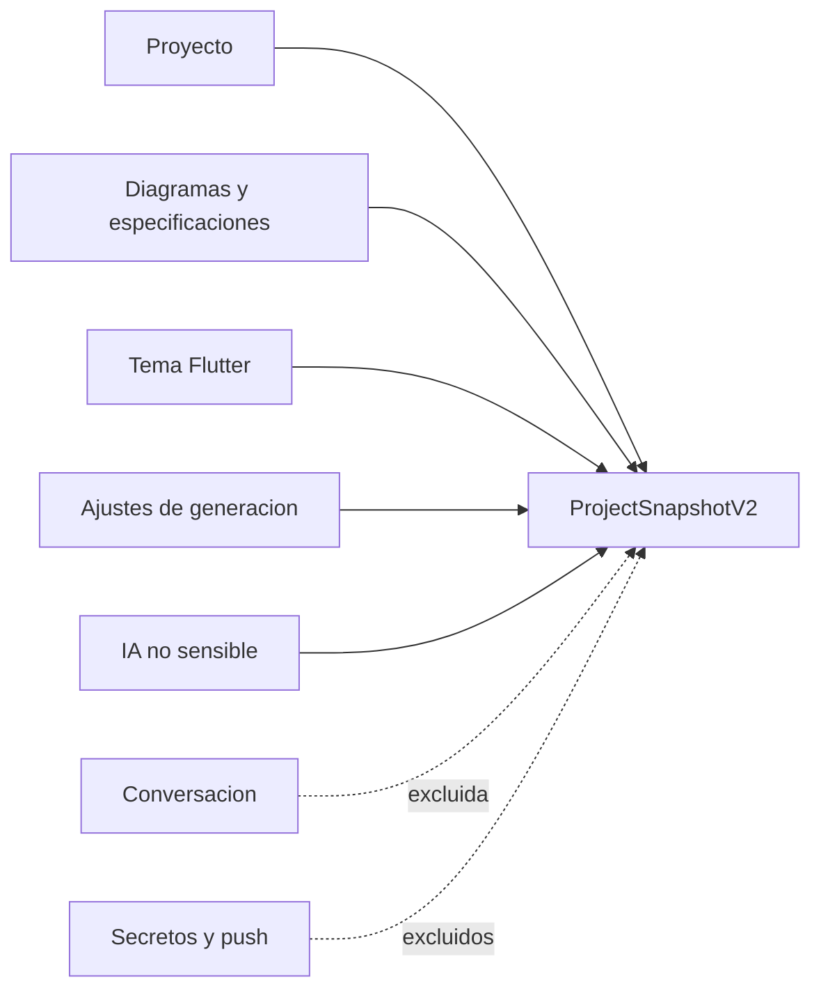

# Modelo de persistencia

## Tablas nuevas

| Tabla | Proposito | Regla principal |
| --- | --- | --- |
| `uml_method_specifications` | Semantica de metodos | Un registro por metodo, cascada |
| `ai_project_settings` | Runtime y politicas IA | Un registro por proyecto |
| `ai_conversations` | Conversacion compartida | Una por proyecto |
| `ai_messages` | Historial ordenado | Secuencia e idempotencia unicas |
| `ai_actions` | Acciones propuestas | Idempotencia por proyecto |
| `ai_recommendations` | Hallazgos persistentes | Estado y severidad restringidos |
| `flutter_theme_settings` | Estilo de generacion | Un tema por proyecto |

## Relaciones

## Restricciones relevantes

- UUID nativos y fechas con zona horaria.
- `CHECK` para proveedor, estados, severidad, riesgo, exposicion y tipo de operacion.
- Mensaje de rol `user` exige autor.
- Contenido entre 1 y 20000 caracteres.
- Secuencia unica por conversacion.
- `client_message_id` unico por conversacion y autor.
- Indices por proyecto, secuencia, correlacion, categoria y tipo de accion.
- Eliminacion de proyecto o conversacion aplica cascada donde la entidad no tiene sentido independiente.

## Snapshot

