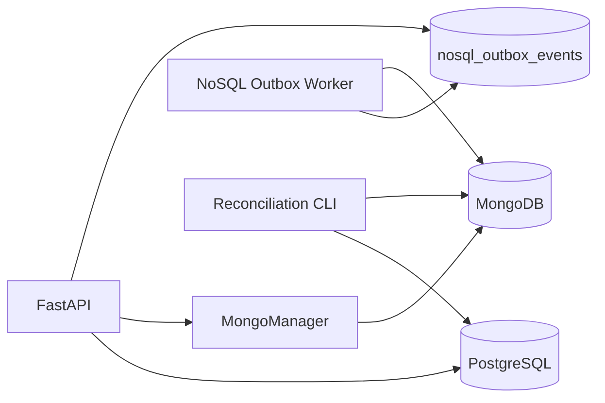

# Arquitectura de persistencia híbrida

## Decisión

CASE Inteligente adopta persistencia políglota:

| Responsabilidad | Autoridad en Fase 10 |
|---|---|
| Identidad, autenticación, permisos y proyectos | PostgreSQL |
| Registro relacional de diagramas, chats y versiones | PostgreSQL |
| Contenido funcional actualmente usado por la aplicación | PostgreSQL |
| Contratos documentales futuros | MongoDB |
| Transferencia durable entre almacenes | Outbox en PostgreSQL |
| Evidencia de aplicación idempotente | MongoDB |

La fase 10 no activa lectura ni escritura funcional dual. Ese límite evita cambiar el comportamiento antes de contar con migraciones por lotes, comparación y rollback en las fases 11 a 13.

## Componentes

## Reglas

1. Los identificadores compartidos son UUID representados como texto en BSON.
2. Todas las fechas BSON son UTC y permanecen como tipo `date`.
3. Todo documento tiene `schema_version`, `_id`, `created_at` y `updated_at`.
4. Diagramas, versiones y mensajes incluyen `content_hash` SHA-256.
5. No se almacenan mensajes o versiones en arreglos crecientes sin límite.
6. Las autorizaciones se resuelven en PostgreSQL antes de consultar documentos de un proyecto.
7. Una transacción PostgreSQL sólo encola el cambio Mongo; el worker lo aplica después del commit.
8. El worker sólo admite `upsert` y `delete`, operaciones repetibles sin duplicar datos.
9. La reconciliación es de sólo lectura y nunca borra datos automáticamente.

## Dependencia oficial

Se utiliza `pymongo>=4.11,<5` y `AsyncMongoClient`. La aplicación no introduce Motor, evitando iniciar una integración sobre un controlador en retirada y manteniendo un único SDK oficial.

## Límite de esta fase

Las interfaces y colecciones existen, pero PostgreSQL sigue atendiendo el editor, XMI, IA, chats, versiones y generadores. El cambio de autoridad se realizará colección por colección con banderas y comparación de hashes.
