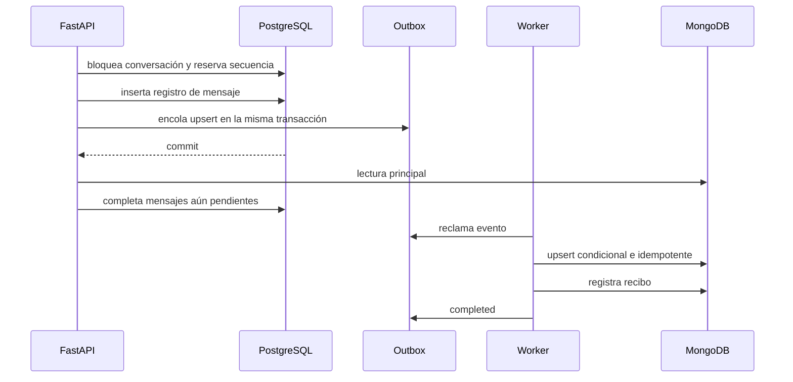

# Arquitectura funcional

## Autoridad de datos

| Dato | Autoridad de lectura | Copia de transición |
|---|---|---|
| Conversación, título, estado y secuencia | PostgreSQL | No aplica |
| Permisos del proyecto | PostgreSQL | No aplica |
| Contenido de mensajes | MongoDB | PostgreSQL |
| Acciones y recomendaciones | PostgreSQL | No aplica |
| Resumen y contexto estructurado | MongoDB | Columna SQL de resumen |
| Eventos pendientes hacia MongoDB | Outbox PostgreSQL | Recibo MongoDB |

La fila SQL de mensaje permanece durante la ventana de estabilización porque acciones y recomendaciones poseen claves foráneas hacia ella. Su contenido completo permite rollback inmediato. La retirada de esa duplicación corresponde a la fase 14.

## Flujo

## Propiedades

- El contador SQL bloqueado conserva una secuencia monotónica por conversación.
- `client_message_id` evita duplicados causados por reconexión o reintento del navegador.
- La lectura Mongo se completa con filas SQL cuya Outbox aún no terminó.
- Un evento antiguo no puede reemplazar un documento más nuevo.
- El cambio de lectura no altera el contrato REST ni WebSocket.
- Toda consulta sigue validando membresía en PostgreSQL.
