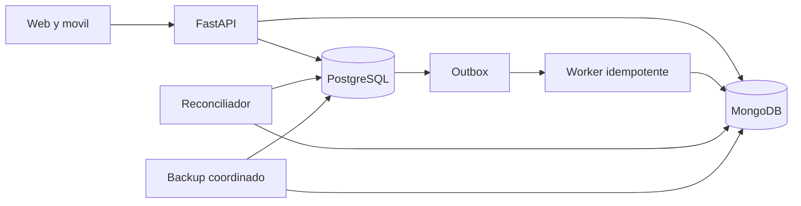

# Arquitectura final

PostgreSQL conserva identidad, autenticacion, proyectos, miembros, permisos, registros de diagramas y conversaciones, revisiones, generaciones, auditoria y Outbox. MongoDB conserva contenido UML activo, snapshots UML, mensajes y contexto extenso.

En produccion el contenido se lee y escribe exclusivamente en MongoDB. El registro SQL aporta autorizacion, identidad y revision, pero no reconstruye clases, relaciones, mensajes ni snapshots. El Outbox permanece para integraciones asincronas y auditoria operativa; no contiene la copia primaria del agregado UML ni del mensaje.
