# Arquitectura del motor unico

## Principio

La plataforma dispone de una sola IA. Su comportamiento cambia segun las intenciones detectadas, pero no existen personalidades ni agentes independientes. La IA puede explicar, revisar, recomendar, coordinar o proponer modificaciones dentro de un mismo resultado.

## Flujo implementado

```mermaid
flowchart LR
    UI[Frontend React] --> API[FastAPI autenticado]
    API --> APP[ProjectAiApplicationService]
    APP --> AUTH[Membresia y permisos]
    APP --> CTX[ProjectContextBuilder]
    APP --> ORCH[UnifiedAiOrchestrator]
    ORCH --> INTENT[IntentClassifier]
    ORCH --> PROMPT[PromptBuilder]
    ORCH --> OLLAMA[OllamaProvider]
    ORCH --> RULES[RuleEngineProvider]
    ORCH --> POLICY[ActionPolicy]
    APP --> DB[(PostgreSQL)]
    API --> EXEC[AiActionExecutionService]
    EXEC --> DOMAIN[Servicios UML y proyectos]
```

## Limites de responsabilidad

- `ai-engine` recibe y devuelve contratos Pydantic. No abre sesiones SQL ni conoce modelos ORM.
- FastAPI verifica identidad, membresia, proyecto, diagrama e idempotencia.
- Ollama solo propone resultados estructurados; no accede a SQL, archivos, shell ni red arbitraria.
- `ActionPolicy` valida tipos, payload, dependencias, ciclos, riesgo y referencias.
- `AiActionExecutionService` contiene el registro cerrado de operaciones permitidas y llama servicios de dominio existentes.
- PostgreSQL conserva la solicitud, respuesta, acciones, recomendaciones, correlacion y estado.

## Secuencia transaccional

1. Se valida usuario y membresia.
2. Se crea o recupera la conversacion unica del proyecto.
3. Se persiste el mensaje del usuario con `status=pending`.
4. Se construye un contexto serializable.
5. Se libera la transaccion de lectura.
6. Se ejecuta la inferencia asincrona bajo un semaforo de concurrencia.
7. Se bloquea la conversacion y se persisten respuesta, acciones y recomendaciones en una transaccion.
8. El mensaje del usuario pasa a `completed`, o a `failed` ante un error no recuperable.

No se mantiene una transaccion de base de datos mientras Ollama procesa la solicitud.

## Compatibilidad

Los endpoints anteriores bajo `/api/v1/ai/...` siguen registrados. La fase agrega un flujo de proyecto nuevo y no modifica las respuestas legacy de texto, voz, imagen, validacion o modificacion UML.
