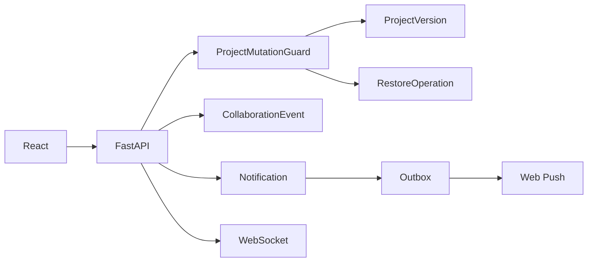

# Arquitectura de versionado

## Separacion de responsabilidades

| Concepto | Persistencia | Comportamiento |
| --- | --- | --- |
| Version guardada | `project_versions` | Snapshot manual inmutable o respaldo previo a restaurar. |
| Restauracion | `project_restore_operations` | Operacion idempotente con estado, hashes y revisiones. |
| Actividad | `collaboration_events` | Secuencia monotona visible para miembros. |
| Auditoria | `audit_logs` | Evidencia administrativa saneada. |
| Conversacion IA | `ai_conversations` y `ai_messages` | Historial independiente que nunca se restaura. |
| Notificacion | `notifications` | Fuente persistente de la bandeja personal. |
| Entrega externa | `notification_outbox` | Reintentos de Web Push posteriores al commit. |

## Consistencia

`ProjectMutationGuard` obtiene `SELECT FOR UPDATE` sobre el proyecto. Lo usan versiones, restauracion, mutaciones UML, especificaciones funcionales y tema Flutter. Cada cambio versionable incrementa `projects.revision`; restaurar contenido antiguo crea una revision nueva, nunca reutiliza una historica.

Los datos generales incluidos en el snapshot, la configuracion de generacion almacenada en el proyecto y la configuracion IA usan el mismo guard. Cambios no versionables, como archivar, no alteran la revision de contenido.

La numeracion se reserva mediante `projects.next_version_number` bajo el mismo bloqueo. Esto evita la carrera de `MAX(version_number) + 1`.

## Flujo

